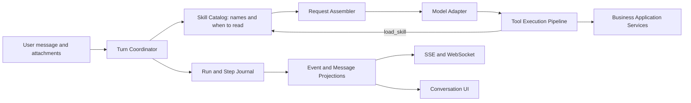

# DinQorAI Agent Harness Refactor

## 1. Decision

DinQorAI will adopt the architectural principles of `deepseek-harness` inside
the existing Spring Boot modular monolith. It will not port Cordis, TypeScript
runtime conventions, or the original project verbatim.

The outcome is a Java-native **Agent Harness** in the `agent` module:

```text
DinQorAI business host
  + Agent Harness Core
  + Skills and policy plugins
  + durable execution journal
  + existing business application services
```

The refactor has two product goals that must be solved together:

1. The agent can use explicit domain skills instead of choosing among a flat
   list of low-level tools.
2. The agent can identify user intent reliably enough to activate the right
   skills, show only relevant tools, request clarification when necessary, and
   enforce approval for side effects.

The design keeps current routes, serialized fields, `agent_conversation`,
`agent_message`, `agent_event`, SSE, WebSocket, ownership checks, billing, and
business-module ownership compatible throughout the migration.

### 1.1 Implementation Status (2026-09-03)

Phase 1 is implemented in commit `98af6f2` (`【dxd】引入智能体Harness执行日志`).
New turns now create `agent_run`; every model request creates and settles an
`agent_step`; every dispatched tool receives and records a stable UUID in
`agent_tool_invocation`. Run completion, failure, stale recovery, tool failure,
and cooperative cancellation all settle the corresponding journal record.

This is intentionally a compatibility-first journal, not the finished core:

- `AgentConversationService` still owns the execution loop and current prompt
  construction.
- The Phase 1 request snapshot contains only safe metadata (context length,
  tool-set hash, attachment count and plan count). The durable messages and
  attachments remain the source for user content.
- The journal records the skill catalog offered to the model and the turn's
  tool names. Deterministic keyword selection — its confidence, reason and
  narrowed tool set — has since been removed; the model loads a skill body
  itself. Uploaded executable Skill packages remain unsupported.
- Existing HTTP, SSE and WebSocket event names and payloads are unchanged.

The next delivery should add the remaining mutation policies.
`email_reminder` and `schedule_plan` now use their journal `invocationId` as
an owning-service create key and reconcile `UNKNOWN` calls with a read-only
business lookup. `publish_post` now reconciles local publication and persisted
CSDN/Juejin successes from owning-module records without any vendor lookup or
republication. A remote success with no durable `blog_publish_record` proof,
as well as deletion and other mutations, stays `UNKNOWN`. `blog_generate`
persists the invocation UUID as its task-create key and reconciles only a
durable `ready` task; it never restarts model work to discover an outcome.
Recognized remote timeouts, connection-access failures and HTTP 5xx responses
now become `UNKNOWN` for read-only reconciliation rather than being reported
as a proven failure.
The keyword Skill resolver is gone (2026-09-04). Every turn now exposes the full
registered tool set, and skills reach the model as a thin loadable catalog
instead of a narrowed capability set: skills decide how the model works, not what
it may call, and approval remains the boundary for external effects. See
`docs/AGENT_SKILL_ROUTING_REFACTOR.md` §9 for what shipped and where it deviates
from that proposal; the sections below still describe the pre-`load_skill`
design and are kept as the record of how the harness got here.

## 2. Current DinQorAI Baseline

The existing implementation is a strong durable-agent foundation, not a
prototype to discard.

| Existing capability | Current implementation | Keep or change |
| --- | --- | --- |
| Conversation ownership | `AgentConversationService` checks `conversationId` and `userId` | Keep |
| Turn fencing | `runVersion` fences messages, events, terminal state, cancellation and recovery | Keep |
| Long-running execution | Worker lease renewal, cancellation checkpoints and stale-running recovery | Keep |
| Replay | `agent_event.id` is the SSE/WS resume cursor | Keep |
| Business integration | `AgentTool` adapters call owning application services | Keep |
| Model routing and billing | `AgentModelClient` and `ModelGateway`; usage charged at terminal result | Keep |
| Tool discovery | Every registered tool is visible by default | Keep: the full table every turn; skills only change how, and approval gates effects |
| Main loop | One service combines lifecycle, context, prompt, model call, tool execution and UI cards | Split into Harness Core components; do not retain a generic self-check retry loop |
| Decision evidence | Messages/events retain outcomes, but not the complete model request policy and capability snapshot | Add durable step snapshots |
| Side-effect replay | Tool result persistence failure after a remote mutation can require reconciliation | Add invocation identity and idempotency policy |

Important existing classes:

- `agent.application.AgentConversationService`: claims a turn and currently
  owns the orchestration loop.
- `agent.application.AgentEventService`: persists and replays events.
- `agent.application.AgentTool` and `AgentToolRegistry`: low-level business
  action adapters and their schemas.
- `agent.application.SubAgentRunner`: bounded nested-agent execution.
- `agent.infrastructure.AgentModelClient`: provider adapter and structured
  decision parsing.

Existing business modules remain authoritative. The Harness must only invoke
them through application services, never through another module's mapper.

## 3. What DeepSeek Harness Contributes

`deepseek-harness` is not valuable because it is a Node or Cordis framework.
Its useful contribution is the separation between a small stable runtime and
composable capabilities.

| DeepSeek Harness principle | DinQorAI adaptation |
| --- | --- |
| Agent capability is composed by plugins | Spring beans implementing `AgentSkill`, policies, presenters and model adapters |
| Append-only session records drive context and replay | Existing messages/events remain compatible; a new run/step journal becomes the execution fact source |
| Prompt and tools are assembled per step | `AgentRequestAssembler` produces an immutable request snapshot |
| Tools pass one guarded pipeline | `ToolExecutionPipeline` enforces the turn tool set, authorization, approval, timeout, cancellation, idempotency and result normalization |
| Host, agent and preset scopes are separate | Spring host owns infrastructure; conversation/run owns state; skill/profile owns capability configuration |
| Subagents are constrained agents, not unrestricted recursion | Durable child invocation with parent link, budget, skill set and summarized hand-back |
| UI presentation is a projection | Quiz, artifact, plan and progress cards are projections of durable execution facts |

The following must **not** be copied mechanically:

- Cordis lifecycle and dependency-injection APIs. Spring already supplies the
  host lifecycle and dependency graph.
- In-memory-only session assumptions. DinQorAI's task execution must remain
  restart-safe and multi-instance-safe.
- A generic plugin marketplace before the skill contract is stable. Initial
  skills are first-party Spring beans, versioned in source and tested.
- Raw prompt or provider payload logging. User content, attachments and model
  responses may be sensitive and must remain protected.

## 4. Target Architecture



### 4.1 Harness Core

The core is intentionally small and owns only execution correctness:

- conversation turn claiming, leases, cancellation, stale recovery and
  terminal transitions;
- request-step sequencing and budget accounting;
- durable run, step and tool-invocation facts;
- model adapter invocation outside database transactions;
- tool pipeline ordering and failure boundaries;
- durable event publication and replay;
- compatibility adapters for the current conversation API.

Suggested package layout:

```text
agent
  application
    harness
      AgentTurnCoordinator
      AgentRunLifecycle
      AgentRequestAssembler
      AgentStepExecutor
      ToolExecutionPipeline
      AgentEventProjector
    skill
      AgentSkill
      AgentSkillCatalog
      LoadSkillTool
    policy
      ToolAuthorizationPolicy
      ToolApprovalPolicy
      ToolIdempotencyPolicy
      AgentBudgetPolicy
  domain
    harness
      AgentRun
      AgentStep
      AgentToolInvocation
      AgentProfile
  infrastructure
    harness
      ... mappers and persistence adapters
```

`AgentConversationService` becomes a compatibility facade for conversation
CRUD, turn claim and public API behavior. It delegates execution to
`AgentTurnCoordinator` instead of containing the loop itself.

### 4.2 Skills Are the Product-Level Capability Unit

> Superseded as written (2026-09-04). The interface below assumed a skill both
> matches an intent and contributes a permitted tool set. Neither survived: the
> tool table is the full registered set every turn and the model picks a skill
> itself. The shipped shape is `id / version / description ("when to read this") /
> toolNames (advisory) / instructions / builtin`, plus `AgentSkillCatalog` and
> `load_skill`. The roster is five — `blog-writing`, `content-publishing`,
> `knowledge-curation`, `study-coach`, `personal-planning`; `general-chat` and
> `artifact-delivery` are gone, since delivery rules now ride with
> `EmitArtifactTool.promptSection` and plain chat needs no skill at all.
> The paragraphs below stay as the original reasoning.

An `AgentTool` remains one atomic action. An `AgentSkill` is a product-level
capability composed from instructions, allowed tools, policies, state and UI
presentation rules.

```java
public interface AgentSkill {
    String id();
    String version();
    SkillMatch match(IntentCandidate intent, AgentConversation conversation);
    SkillContribution contribute(AgentSkillContext context);
}
```

`SkillContribution` declares, at minimum:

- skill prompt/instructions and prompt version;
- permitted tool names and tool-specific policy overrides;
- required user data or clarification fields;
- maximum steps, token budget and allowed child skills;
- approval requirements for mutations;
- optional result presenter for cards or resource links.

Initial first-party skills map current capabilities into coherent user goals:

| Skill ID | Main tools/adapters | Mandatory policy |
| --- | --- | --- |
| `general-chat` | no mutable business tool by default | answer or clarify only |
| `blog-writing` | blog generation, image generation, draft/query tools | creates drafts; never publishes directly |
| `content-publishing` | query post, publish post | explicit user confirmation before publish |
| `knowledge-curation` | query/create knowledge, memory | preserve source/reference metadata |
| `study-coach` | quiz, grade, recall, plan/reminder tools | diagnose before testing; score only through grading tool |
| `personal-planning` | plan and reminder tools | changes require clear time and user intent |
| `artifact-delivery` | artifact tool | persisted structured deliverable required for multi-file code |

Skills are not arbitrary executable code from users. In the first version they
are trusted, compiled Spring beans. A future external extension model requires
its own sandbox, signing, tenancy and review design.

### 4.3 Intent and Skill Resolution

Intent resolution is a constrained semantic classification step, not a keyword
router and not an unrestricted agent loop.

```text
message + recent turn + conversation profile
  -> structured intent decision
  -> candidate skills
  -> deterministic policy validation
  -> active skill profile or clarification
```

The decision is structured and persisted, for example:

```json
{
  "goal": "draft a blog post about RAG evaluation",
  "mode": "execute",
  "skills": ["blog-writing"],
  "confidence": 0.92,
  "missingInformation": [],
  "requiresConfirmation": false
}
```

Rules after model classification are deterministic:

- Select only registered skills and valid combinations.
- Reject conflicting skill combinations, or choose a defined priority.
- If confidence is below a configured threshold or required information is
  missing, activate `clarification` rather than guessing.
- A mutation is never authorized by confidence alone. The corresponding skill
  and tool approval policy must permit it.
- Conversation state can constrain resolution. A pending approval or open quiz
  is continued before starting an unrelated workflow unless the user clearly
  changes the subject.

The resolver's chosen skills, confidence, missing fields, policy outcome and
skill versions are stored on the run. This makes intent quality measurable and
allows offline evaluation against labeled conversations.

### 4.4 Step Request Assembly

`AgentRequestAssembler` creates an immutable `AgentStepRequest` for each
model call. It replaces the service-local string construction currently inside
`AgentConversationService.buildContext`.

An assembled request contains references or snapshots of:

- conversation/run/step IDs and user ID;
- selected skills and exact versions;
- profile and policy versions;
- selected tool schemas and a schema-set hash;
- model route/provider/model and reasoning configuration;
- message IDs in the context window and attachment IDs/snapshots;
- memory and plan snapshot versions;
- current step, remaining token/step budget and cancellation capability;
- system and skill instruction version identifiers;
- response-language policy version: reply in the current user's natural
  language, defaulting to Chinese only when the input is linguistically
  ambiguous or consists only of names/identifiers;
- normalized model output contract.

The model may still receive a compact rendered context. The journal persists
the stable inputs needed to explain and reproduce the decision without
recording API keys or indiscriminately logging raw private data.

### 4.5 One Tool Pipeline

All model-requested tools pass through exactly one pipeline:

```text
model action
  -> schema validation
  -> visible-in-current-skill check
  -> user ownership / authorization check
  -> approval check
  -> durable invocation intent
  -> idempotency / reconciliation check
  -> execute outside transaction
  -> durable normalized result
  -> model, UI and audit projections
```

The pipeline owns cancellation semantics. A cancellation before execution marks
the invocation cancelled. A cancellation during a non-cancellable remote side
effect produces an explicit `outcome_unknown` or `reconciliation_required`
state; it must never claim that the side effect did not happen.

Mutating tool adapters must accept a stable `invocationId` as their business
idempotency key where the owning module supports it. This is especially
required for publishing, creating reminders/plans, charging and externally
visible mutations.

### 4.6 Events, Messages and Projections

The current `agent_event` and `agent_message` tables stay public-compatible.
They become projections, while run/step/invocation records describe what
actually happened.

| Fact | Durable source | Projection |
| --- | --- | --- |
| Turn accepted | `agent_run` | `started` event |
| Intent and selected skills | `agent_run` | optional skill/status event |
| Model request and decision | `agent_step` | thought/answer delta events where safe |
| Tool invocation/result | `agent_tool_invocation` | `tool_start`, progress, `tool_end`, `tool_error` |
| Quiz/artifact/plan render data | invocation result + message projection | card message and card event |
| Terminal state | `agent_run` and conversation state | `complete` or `error` event |

SSE and WebSocket keep replaying the current event contract during the
migration. Event payloads gain a `schemaVersion` when a new typed event form is
introduced. Consumers must ignore unknown optional fields.

### 4.7 Subagents

`delegate_subtask` remains useful but becomes a child execution relationship:

- a parent tool invocation creates a child run/invocation record;
- child skills and tools are an explicit subset of parent capabilities;
- child steps and token budget are independently bounded;
- child events are linked for audit but only a concise normalized finding is
  returned to the parent model context;
- child work cannot alter parent plan state unless a parent-owned tool performs
  that action;
- cancelled parents propagate cancellation to children cooperatively.

This retains the present isolation benefit of `SubAgentRunner` while making
restart, accounting and duplicate handling explicit.

## 5. Data Model Additions

The following names are proposed; final naming follows the repository schema
conventions and all columns/tables require Chinese SQL comments.

| Table | Ownership | Purpose |
| --- | --- | --- |
| `agent_run` | `agent` | One claimed user turn: lifecycle, selected profile/skills, intent, budget, model-route snapshot and parent relationship |
| `agent_step` | `agent` | One intent/model/tool/finalization decision step, with request snapshot, decision, timing, usage and terminal outcome |
| `agent_tool_invocation` | `agent` | Immutable tool-call identity, policy decision, approval state, idempotency key, normalized result/error and reconciliation state |
| `agent_approval` | `agent` | Explicit user approval or rejection for a pending action, linked to invocation and owner |

All new tables include user/conversation/run ownership references, state,
timestamps and indexes for `(conversation_id, run_version)`, pending work,
parent invocation and unique idempotency keys. No foreign key should create a
cross-module ownership dependency that prevents the owning business module
from retaining its own lifecycle.

Do not replace `agent_event` or `agent_message` in the first migration. Add
new records beside them, backfill only where there is an unambiguous mapping,
and make new runs write both the journal and current projections.

Phase 1 added the first three tables and their baseline/upgrade migrations.
`agent_approval` remains pending for Phase 3 because no current API can safely
create, display, resume and reject a pending action yet.

## 6. Migration Plan

### Phase 0: Baseline and Contract Tests

- Freeze the current HTTP, SSE and WebSocket event contract in tests.
- Add end-to-end-style application tests for claim, stale worker fencing,
  cancellation, replay and tool-result persistence failures.
- Capture a small anonymized intent evaluation corpus from representative user
  requests: writing, publishing, learning, knowledge, planning and ambiguous
  requests.

### Phase 1: Introduce the Harness Journal

- Add `agent_run`, `agent_step` and `agent_tool_invocation` schema and
  migrations.
- Introduce typed domain states and repository interfaces.
- Make the existing loop write run and step facts without changing its visible
  behavior.
- Add a durable `invocationId` before every tool execution.

Exit criterion: a completed or failed turn can be traced from run to every
model step and tool invocation; existing clients work unchanged.

**Status: completed in `98af6f2`.** The journal uses `(conversation_id,
run_version)` as the unique run fence and `invocation_id` as the unique durable
tool-call identity. Existing message and event projections remain the public
compatibility surface. A following Phase 2 change must enrich the safe request
snapshot; it must not redesign this schema or replay historical rows.

### Phase 2: Extract Execution Components

- Extract lifecycle, request assembly, step execution and event projection
  from `AgentConversationService`.
- Keep its public methods as delegates so API callers do not need a flag day.
- Move prompt text to versioned `AgentInstructionSet` and remove UI-specific
  card branches from the coordinator.

Exit criterion: `AgentConversationService` no longer contains a monolithic
model/tool loop, and unit tests cover each extracted policy boundary.

**Status: in progress.** Checkpoint `419f5dd` (`【dxd】拆分智能体请求与步骤执行`)
completed `AgentRequestAssembler`, immutable `AgentStepRequest`, and
`AgentStepExecutor`. The exact model input and version 2 journal snapshot now
come from one message window, and one model call settles its matching step.
The request now instructs the model to reply in the current user's natural
language; only linguistically ambiguous requests, including names and
identifiers without natural-language context, default to Chinese. The following
lifecycle extraction moves run claim validation, fenced cancellation,
cancellation checks, lease renewal, successful/failed transitions, and
stale-run recovery into `AgentRunLifecycle`. Tool execution and compatibility
event projection remain in the facade until their own behavior-preserving
extractions are tested.

The next extraction adds `AgentEventProjector`. It owns the existing active-run
message fence, durable legacy-event projection, listener delivery, plan-card
upsert, and tool-progress payload shape. The loop still decides when a thought,
tool, plan, quiz, artifact, or answer exists; it delegates only persistence and
projection, preserving event names, ordering, and serialized fields.

The generic reflection loop has been retired by product decision. A `done=true`
decision is projected immediately: unfinished plan items, a missing quiz or
artifact card, and an unacknowledged tool failure no longer cause an automatic
critique event or another model call. Tool failures remain durable facts in the
next request context, so the model can voluntarily retry or explain them.
`deepThinking` remains accepted and journaled for API compatibility but no
longer enables hidden self-check retries.

### Phase 3: Tool Pipeline and Idempotency

- Route every current `AgentTool` through `ToolExecutionPipeline`.
- Classify tools as read-only, internal state mutation, external mutation or
  asynchronous hand-off.
- Add approval and reconciliation implementations for publication, reminders,
  schedules and other externally visible writes.

Exit criterion: process interruption after a remote mutation cannot cause a
blind duplicate operation; the system either returns a stored result or enters
a visible reconciliation state.

**Status: partially implemented.** `AgentToolExecutionPipeline` is now the
single execution boundary for main-loop tools. It rejects tools outside the
active Skill set and missing required schema fields before it persists a
durable invocation UUID. Stale failures settle running invocations to
`UNKNOWN`, which prevents the journal from claiming that the operation never
started. `email_reminder` and `schedule_plan` now persist the same invocation
ID as a per-user unique create key, and a scheduled read-only reconciler moves
only proven effects to `SUCCEEDED`. `publish_post` can likewise settle local,
CSDN, and Juejin outcomes only when their owning modules have persisted proof;
it never probes a vendor or retries publication to discover the result.
`blog_generate` similarly settles only a ready task tied to its invocation
key. Recognized remote timeouts, connection-access failures and HTTP 5xx
responses become `UNKNOWN`; validation and determinate business failures stay
`FAILED`. Policies for the remaining mutations are still required before any
automatic retry.

High-impact approval is now durable for `publish_post`, `email_reminder`,
`schedule_plan`, and destructive plan/reminder updates. The pipeline writes an
`agent_approval` record and changes the conversation/run/invocation to a
waiting state before any side effect. The owner can approve or reject through
the approval API; approval resumes the original invocation UUID without a new
model call, while rejection cancels it. Approved work that crashes still needs
its tool-specific reconciliation policy before automatic recovery is enabled.

### Phase 4: Skills and Intent Resolver

The bullets below are the original plan; the resolver half of it was dropped.
Read the status note after them for what exists.

- Add first-party skills and map existing tools into them.
- Add structured intent classification with deterministic validation and a
  clarification path.
- Start in shadow mode: persist resolver output but execute the legacy all-tool
  profile; compare selected skills against observed successful tool paths.
- Enable skill-scoped tool visibility per user cohort after accuracy targets
  are met.

Exit criterion: every normal turn has a selected skill profile, and the model
sees only tools allowed by that profile.

**Status: superseded (2026-09-04).** The exit criterion above was abandoned on
purpose, because narrowing the model surface was itself the defect: a request
for a plain SSE snippet matched the delivery keyword list, the turn kept only
`emit_artifact`, and the model had no way to answer with a code fence. What
shipped instead: the tool table is the full registered set every turn,
`AgentSkillCatalog` renders one thin catalog of skill names plus when-to-read
lines, and `load_skill` pulls back a single body once the model decides the turn
belongs to it. A loaded body is pinned in context (it survives the count window
and the compaction floor, deduped per skill, capped at the three newest) so the
model keeps following the original text rather than a summary of it. Trusted
compiled skills cover writing, publishing, study, knowledge curation and
personal planning; user-authored skills are `agent_skill` rows that now take
effect with no code change or restart. Approval, not visibility, holds external
effects. No semantic intent classifier is needed on this path, and no labeled
corpus is required to evaluate one. User-uploaded *executable* skills remain
intentionally unsupported until signing, tenancy and sandbox rules exist. Full
detail and the deliberate deviations are in
`docs/AGENT_SKILL_ROUTING_REFACTOR.md` §9.

### Phase 5: Durable Subagents and Typed UI Projections

- Move `SubAgentRunner` to child-run records.
- Convert quiz, plan and artifact handling into registered result presenters.
- Add versioned event payloads while retaining legacy event names/fields.

Exit criterion: a child task is traceable and recoverable independently, and
new card types do not require changes to the turn coordinator.

### Phase 6: Retire Compatibility Paths

- Remove legacy prompt/tool selection branches only after migration telemetry
  and regression tests demonstrate equivalence or improvement.
- Keep historical message/event reads indefinitely or provide an explicit
  versioned reader for old conversations.

### 6.1 Phase 2 Target Components

The next change is a behavior-preserving extraction from
`AgentConversationService`. It must not enable skill filtering, alter model
prompt text, add a new public endpoint, or change the SSE/WebSocket vocabulary.

| New component | Owns | Must not own |
| --- | --- | --- |
| `AgentTurnCoordinator` | claimed-turn sequencing and terminal delegation | lifecycle state transitions, prompt rendering, tool-specific UI cards or business operations |
| `AgentRequestAssembler` | immutable `AgentStepRequest` creation, context message IDs, attachment references, tool-schema-set hash, model route and instruction/profile version IDs | remote model I/O or message/event persistence |
| `AgentStepExecutor` | one model invocation and normalized decision hand-off | turn claiming, final terminal transition or direct UI presentation |
| `AgentEventProjector` | deriving current `agent_message` and `agent_event` compatibility records from run/step/invocation facts | model calls, tool execution and business state changes |
| `AgentRunLifecycle` | claim validation, fenced cancellation and cancellation checks, lease renewal, journal terminal transitions and stale-run reconciliation | API transport or live event fan-out |

`AgentStepRequest` must persist stable references rather than duplicate user
content: ordered `agent_message.id` values, attachment snapshots/URLs already
owned by those messages, selected tool names plus a schema-set hash, model
route, instruction-set version, remaining budget, and the active run/step
identity. The rendered context is derived from those records. When a future
field is model-visible, it must either be a durable fact or have a durable
version/reference sufficient to reproduce the request.

Phase 2 tests must freeze the current public behavior before moving code:

1. Claim, lease-renewal, stale-worker fencing and cancellation retain their
   present `runVersion` semantics.
2. A completed run has an ordered run -> step -> invocation trace and each step
   names the exact message IDs and tool-schema-set hash used for the request.
3. An interrupted model call settles its running step; an interrupted tool call
   retains its invocation identity and cannot be reported as unexecuted.
4. Existing SSE replay and WebSocket replay tests continue to accept the same
   event IDs, names and legacy payload fields.

### 6.2 DeepSeek Harness Comparison and Adopted Decisions

The comparison was made against `deepseek-harness` source at
`packages/core/agent-loop`, `packages/core/session`, `packages/core/tools`,
`packages/skill/skill`, `packages/interaction/user-approval`, and
`packages/session/session-projection`. The following mechanisms are adopted as
principles, not as a TypeScript or Cordis port.

| DeepSeek Harness mechanism | DinQorAI interpretation | Delivery phase |
| --- | --- | --- |
| Append-only session log is the model-history source; model-visible input must be logged or reconstructable | `agent_message` remains user-content source; Phase 2 records the exact message/attachment references and versioned assembly inputs on `agent_step` | Phase 2 |
| Turn and step driver has explicit pre-step/request/step-end extension points | Extract coordinator, assembler and executor before adding policies, so later skills and intent handling do not reopen the monolithic loop | Phase 2 |
| One guarded `pre-execute` / `execute` / `post-execute` tool pipeline | Introduce `ToolExecutionPipeline` around the already durable invocation ID; perform visibility, authorization, approval, cancellation, idempotency and result normalization there | Phase 3 |
| Approval writes an asked/decided durable pair inside the owning turn and fails closed without an answerer | Add `agent_approval` and an approval-resume path tied to the exact invocation fingerprint; no mutation may wait only in memory | Phase 3 |
| Skills are provider-merged, scoped catalogs with explicit model/user invocation policy | Built-in DinQorAI skills stay trusted compiled Spring beans and user skills stay text bodies in `agent_skill`. `AgentSkillCatalog` merges both into one thin per-turn catalog and `load_skill` fetches a body on the model's own decision; no tool narrowing, no external marketplace, no user-supplied executable skill | Phase 4 |
| Client cards are pure projections of durable tool facts | Move quiz, plan and artifact branches out of the coordinator into registered result presenters after the tool pipeline is stable | Phase 5 |
| Child agents carry explicit parent links, isolation and settlement | Replace the current bounded `SubAgentRunner` execution with child run/invocation records only after parent journal and policy boundaries are stable | Phase 5 |

The Harness supports plugin-tree hot composition, workspace sandboxing and
generic process tools. DinQorAI must not copy those areas: Spring owns bean
composition, business modules remain the authority for domain mutations, and
the product requires durable MySQL ownership/fencing rather than local session
files. The useful invariant is smaller: new behavior contributes through a
documented core/policy/skill/presenter extension point instead of adding another
branch to the conversation loop.

## 7. Safety and Operational Rules

- External model, tool and network calls remain outside transactions.
- A conditional transition on `runVersion` remains mandatory for every write
  made by an active worker.
- A durable event is written before live fan-out; a disconnected subscriber
  never owns or cancels execution.
- Tools must receive explicit user and run/invocation identity, never rely on
  request thread context in background work.
- Prompt snapshots, model output and attachment metadata are sensitive. Store
  only the minimum required for replay/audit, redact logs, and encrypt any
  persisted payload that needs stronger protection.
- Approval must be durable and tied to the exact invocation fingerprint. A
  changed action requires a new approval.
- Skills may narrow capability; they cannot grant a tool or permission that
  the user/profile policy does not allow.

## 8. Acceptance Criteria

The refactor is complete only when all of the following are true:

1. For a run, operators can identify the selected skills, intent confidence,
   tool set, model route, step decisions and tool outcomes without reading
   application logs.
2. A model never sees a tool outside the active skill/profile policy.
3. Ambiguous or incomplete requests produce a clarification before a mutation.
4. A publish/reminder/plan mutation is approved where required and is not
   duplicated after worker crash, retry or client reconnect.
5. Cancellation reports the actual durable state, including cases awaiting
   remote reconciliation.
6. SSE and WebSocket clients retain event-ID replay and old clients continue to
   parse their existing events.
7. The agent resumes safely after restart or stale lease recovery; a delayed
   worker cannot write to a newer run.
8. Intent and skill-selection evaluation is measurable with a fixed test set,
   including false-positive mutation tests.
9. Narrow module tests and the full Maven suite pass for each delivered phase.

## 9. Implementation Order and Progress

Completed by the first pull request (`98af6f2`):

1. [x] Add typed run/step/invocation domain records and SQL migrations.
2. [x] Persist one `agent_run` when `prepareTurn` claims a conversation.
3. [x] Persist an `agent_step` around the current model decision.
4. [x] Persist `agent_tool_invocation` before and after the current tool call.
5. [x] Add journal schema and invocation-identity regression tests, then run
   the full Maven suite.

Completed Phase 2 checkpoint (`419f5dd`):

1. [x] Add `AgentStepRequest` and `AgentRequestAssembler` with durable
   message/attachment references and versioned assembly inputs.
2. [x] Extract `AgentStepExecutor` behind the existing
   `AgentConversationService` facade.

Completed Phase 2 lifecycle checkpoint:

1. [x] `AgentRunLifecycle` owns claim-state validation, explicit cancellation,
   cancellation checks, lease renewal, and successful/failed/stale terminal
   transitions fenced by `runVersion`. It returns durable outcomes and does not
   fan out live events or charge billing.
2. [x] Preserve the existing facade constructor for focused loop tests and
   embedded callers while moving the lease executor dependency to the lifecycle.

Completed Phase 2 event projection checkpoint:

1. [x] `AgentEventProjector` owns active-run message fencing, plan-card upsert,
   durable legacy-event projection, listener delivery, and tool-progress payload
   shaping; direct tests freeze those compatibility behaviors.
2. [x] Keep the loop responsible for deciding whether a tool result creates a
   plan, quiz, artifact, thought, or answer projection.

Completed generic self-check retirement:

1. [x] Remove `AgentTurnEvaluator` and all automatic `reflection` retry paths.
2. [x] Freeze direct-delivery behavior for `done=true`, including unfinished
   plans, tool failures, code claims, quiz requests, and `deepThinking=true`.
3. [x] Preserve historical `reflection` messages and event vocabulary for old
   conversation replay; new turns do not create them.

Next Phase 2 extraction batch:

1. [x] `AgentTurnCoordinator` owns claimed-turn lease start/stop, supersession
   handling, terminal failure persistence, live error delivery, and queue-entry
   failure handling. It also owns `agent_step` creation and model-step execution;
    it delegates durable tool invocation creation, validation and settlement to
    `AgentToolExecutionPipeline`. The facade retains compatibility projections
    and tool-path sequencing.
2. [x] Add first-party Skill selection and a narrowed per-run tool surface.
3. [~] Add crash/retry, request-reconstruction and SSE/WebSocket compatibility
   tests for the extracted boundaries. Stale invocations now settle to
   `UNKNOWN`; reminder and plan creation prove outcomes through a read-only
   reconciler. Approval request, decision, and same-invocation resume now have
   unit coverage; remote reconciliation scenarios remain.

The next implementation batch is external-mutation reconciliation and timeout
policy, not a larger Skill catalog. The main capability boundary now exists;
external publication, charging and generation need owning-module proof of
outcome before the product permits automatic retries.
