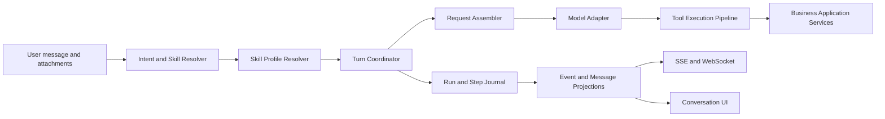

# DinQorAI Agent Harness Refactor

## 1. Decision

DinQorAI will adopt the architectural principles of `deepseek-harness` inside
the existing Spring Boot modular monolith. It will not port Cordis, TypeScript
runtime conventions, or the original project verbatim.

The outcome is a Java-native **Agent Harness** in the `agent` module:

```text
DinQorAI business host
  + Agent Harness Core
  + Skills and policy plugins
  + durable execution journal
  + existing business application services
```

The refactor has two product goals that must be solved together:

1. The agent can use explicit domain skills instead of choosing among a flat
   list of low-level tools.
2. The agent can identify user intent reliably enough to activate the right
   skills, show only relevant tools, request clarification when necessary, and
   enforce approval for side effects.

The design keeps current routes, serialized fields, `agent_conversation`,
`agent_message`, `agent_event`, SSE, WebSocket, ownership checks, billing, and
business-module ownership compatible throughout the migration.

## 2. Current DinQorAI Baseline

The existing implementation is a strong durable-agent foundation, not a
prototype to discard.

| Existing capability | Current implementation | Keep or change |
| --- | --- | --- |
| Conversation ownership | `AgentConversationService` checks `conversationId` and `userId` | Keep |
| Turn fencing | `runVersion` fences messages, events, terminal state, cancellation and recovery | Keep |
| Long-running execution | Worker lease renewal, cancellation checkpoints and stale-running recovery | Keep |
| Replay | `agent_event.id` is the SSE/WS resume cursor | Keep |
| Business integration | `AgentTool` adapters call owning application services | Keep |
| Model routing and billing | `AgentModelClient` and `ModelGateway`; usage charged at terminal result | Keep |
| Tool discovery | Every registered tool is visible by default | Replace with skill-driven capability selection |
| Main loop | One service combines lifecycle, context, prompt, model call, tool execution, UI cards and reflection | Split into Harness Core components |
| Decision evidence | Messages/events retain outcomes, but not the complete model request policy and capability snapshot | Add durable step snapshots |
| Side-effect replay | Tool result persistence failure after a remote mutation can require reconciliation | Add invocation identity and idempotency policy |

Important existing classes:

- `agent.application.AgentConversationService`: claims a turn and currently
  owns the orchestration loop.
- `agent.application.AgentEventService`: persists and replays events.
- `agent.application.AgentTool` and `AgentToolRegistry`: low-level business
  action adapters and their schemas.
- `agent.application.SubAgentRunner`: bounded nested-agent execution.
- `agent.infrastructure.AgentModelClient`: provider adapter and structured
  decision parsing.

Existing business modules remain authoritative. The Harness must only invoke
them through application services, never through another module's mapper.

## 3. What DeepSeek Harness Contributes

`deepseek-harness` is not valuable because it is a Node or Cordis framework.
Its useful contribution is the separation between a small stable runtime and
composable capabilities.

| DeepSeek Harness principle | DinQorAI adaptation |
| --- | --- |
| Agent capability is composed by plugins | Spring beans implementing `AgentSkill`, policies, presenters and model adapters |
| Append-only session records drive context and replay | Existing messages/events remain compatible; a new run/step journal becomes the execution fact source |
| Prompt and tools are assembled per step | `AgentRequestAssembler` produces an immutable request snapshot |
| Tools pass one guarded pipeline | `ToolExecutionPipeline` enforces visibility, authorization, approval, timeout, cancellation, idempotency and result normalization |
| Host, agent and preset scopes are separate | Spring host owns infrastructure; conversation/run owns state; skill/profile owns capability configuration |
| Subagents are constrained agents, not unrestricted recursion | Durable child invocation with parent link, budget, skill set and summarized hand-back |
| UI presentation is a projection | Quiz, artifact, plan and progress cards are projections of durable execution facts |

The following must **not** be copied mechanically:

- Cordis lifecycle and dependency-injection APIs. Spring already supplies the
  host lifecycle and dependency graph.
- In-memory-only session assumptions. DinQorAI's task execution must remain
  restart-safe and multi-instance-safe.
- A generic plugin marketplace before the skill contract is stable. Initial
  skills are first-party Spring beans, versioned in source and tested.
- Raw prompt or provider payload logging. User content, attachments and model
  responses may be sensitive and must remain protected.

## 4. Target Architecture



### 4.1 Harness Core

The core is intentionally small and owns only execution correctness:

- conversation turn claiming, leases, cancellation, stale recovery and
  terminal transitions;
- request-step sequencing and budget accounting;
- durable run, step and tool-invocation facts;
- model adapter invocation outside database transactions;
- tool pipeline ordering and failure boundaries;
- durable event publication and replay;
- compatibility adapters for the current conversation API.

Suggested package layout:

```text
agent
  application
    harness
      AgentTurnCoordinator
      AgentRunLifecycle
      AgentRequestAssembler
      AgentStepExecutor
      ToolExecutionPipeline
      AgentEventProjector
    skill
      AgentSkill
      AgentSkillRegistry
      IntentSkillResolver
      AgentProfileResolver
    policy
      ToolVisibilityPolicy
      ToolAuthorizationPolicy
      ToolApprovalPolicy
      ToolIdempotencyPolicy
      AgentBudgetPolicy
  domain
    harness
      AgentRun
      AgentStep
      AgentToolInvocation
      AgentIntent
      AgentSkillSelection
      AgentProfile
  infrastructure
    harness
      ... mappers and persistence adapters
```

`AgentConversationService` becomes a compatibility facade for conversation
CRUD, turn claim and public API behavior. It delegates execution to
`AgentTurnCoordinator` instead of containing the loop itself.

### 4.2 Skills Are the Product-Level Capability Unit

An `AgentTool` remains one atomic action. An `AgentSkill` is a product-level
capability composed from instructions, allowed tools, policies, state and UI
presentation rules.

```java
public interface AgentSkill {
    String id();
    String version();
    SkillMatch match(IntentCandidate intent, AgentConversation conversation);
    SkillContribution contribute(AgentSkillContext context);
}
```

`SkillContribution` declares, at minimum:

- skill prompt/instructions and prompt version;
- permitted tool names and tool-specific policy overrides;
- required user data or clarification fields;
- maximum steps, token budget and allowed child skills;
- approval requirements for mutations;
- optional result presenter for cards or resource links.

Initial first-party skills map current capabilities into coherent user goals:

| Skill ID | Main tools/adapters | Mandatory policy |
| --- | --- | --- |
| `general-chat` | no mutable business tool by default | answer or clarify only |
| `blog-writing` | blog generation, image generation, draft/query tools | creates drafts; never publishes directly |
| `content-publishing` | query post, publish post | explicit user confirmation before publish |
| `knowledge-curation` | query/create knowledge, memory | preserve source/reference metadata |
| `study-coach` | quiz, grade, recall, plan/reminder tools | diagnose before testing; score only through grading tool |
| `personal-planning` | plan and reminder tools | changes require clear time and user intent |
| `artifact-delivery` | artifact tool | persisted structured deliverable required for multi-file code |

Skills are not arbitrary executable code from users. In the first version they
are trusted, compiled Spring beans. A future external extension model requires
its own sandbox, signing, tenancy and review design.

### 4.3 Intent and Skill Resolution

Intent resolution is a constrained semantic classification step, not a keyword
router and not an unrestricted agent loop.

```text
message + recent turn + conversation profile
  -> structured intent decision
  -> candidate skills
  -> deterministic policy validation
  -> active skill profile or clarification
```

The decision is structured and persisted, for example:

```json
{
  "goal": "draft a blog post about RAG evaluation",
  "mode": "execute",
  "skills": ["blog-writing"],
  "confidence": 0.92,
  "missingInformation": [],
  "requiresConfirmation": false
}
```

Rules after model classification are deterministic:

- Select only registered skills and valid combinations.
- Reject conflicting skill combinations, or choose a defined priority.
- If confidence is below a configured threshold or required information is
  missing, activate `clarification` rather than guessing.
- A mutation is never authorized by confidence alone. The corresponding skill
  and tool approval policy must permit it.
- Conversation state can constrain resolution. A pending approval or open quiz
  is continued before starting an unrelated workflow unless the user clearly
  changes the subject.

The resolver's chosen skills, confidence, missing fields, policy outcome and
skill versions are stored on the run. This makes intent quality measurable and
allows offline evaluation against labeled conversations.

### 4.4 Step Request Assembly

`AgentRequestAssembler` creates an immutable `AgentStepRequest` for each
model call. It replaces the service-local string construction currently inside
`AgentConversationService.buildContext`.

An assembled request contains references or snapshots of:

- conversation/run/step IDs and user ID;
- selected skills and exact versions;
- profile and policy versions;
- selected tool schemas and a schema-set hash;
- model route/provider/model and reasoning configuration;
- message IDs in the context window and attachment IDs/snapshots;
- memory and plan snapshot versions;
- current step, remaining token/step budget and cancellation capability;
- system and skill instruction version identifiers;
- normalized model output contract.

The model may still receive a compact rendered context. The journal persists
the stable inputs needed to explain and reproduce the decision without
recording API keys or indiscriminately logging raw private data.

### 4.5 One Tool Pipeline

All model-requested tools pass through exactly one pipeline:

```text
model action
  -> schema validation
  -> visible-in-current-skill check
  -> user ownership / authorization check
  -> approval check
  -> durable invocation intent
  -> idempotency / reconciliation check
  -> execute outside transaction
  -> durable normalized result
  -> model, UI and audit projections
```

The pipeline owns cancellation semantics. A cancellation before execution marks
the invocation cancelled. A cancellation during a non-cancellable remote side
effect produces an explicit `outcome_unknown` or `reconciliation_required`
state; it must never claim that the side effect did not happen.

Mutating tool adapters must accept a stable `invocationId` as their business
idempotency key where the owning module supports it. This is especially
required for publishing, creating reminders/plans, charging and externally
visible mutations.

### 4.6 Events, Messages and Projections

The current `agent_event` and `agent_message` tables stay public-compatible.
They become projections, while run/step/invocation records describe what
actually happened.

| Fact | Durable source | Projection |
| --- | --- | --- |
| Turn accepted | `agent_run` | `started` event |
| Intent and selected skills | `agent_run` | optional skill/status event |
| Model request and decision | `agent_step` | thought/answer delta events where safe |
| Tool invocation/result | `agent_tool_invocation` | `tool_start`, progress, `tool_end`, `tool_error` |
| Quiz/artifact/plan render data | invocation result + message projection | card message and card event |
| Terminal state | `agent_run` and conversation state | `complete` or `error` event |

SSE and WebSocket keep replaying the current event contract during the
migration. Event payloads gain a `schemaVersion` when a new typed event form is
introduced. Consumers must ignore unknown optional fields.

### 4.7 Subagents

`delegate_subtask` remains useful but becomes a child execution relationship:

- a parent tool invocation creates a child run/invocation record;
- child skills and tools are an explicit subset of parent capabilities;
- child steps and token budget are independently bounded;
- child events are linked for audit but only a concise normalized finding is
  returned to the parent model context;
- child work cannot alter parent plan state unless a parent-owned tool performs
  that action;
- cancelled parents propagate cancellation to children cooperatively.

This retains the present isolation benefit of `SubAgentRunner` while making
restart, accounting and duplicate handling explicit.

## 5. Data Model Additions

The following names are proposed; final naming follows the repository schema
conventions and all columns/tables require Chinese SQL comments.

| Table | Ownership | Purpose |
| --- | --- | --- |
| `agent_run` | `agent` | One claimed user turn: lifecycle, selected profile/skills, intent, budget, model-route snapshot and parent relationship |
| `agent_step` | `agent` | One intent/model/tool/finalization decision step, with request snapshot, decision, timing, usage and terminal outcome |
| `agent_tool_invocation` | `agent` | Immutable tool-call identity, policy decision, approval state, idempotency key, normalized result/error and reconciliation state |
| `agent_approval` | `agent` | Explicit user approval or rejection for a pending action, linked to invocation and owner |

All new tables include user/conversation/run ownership references, state,
timestamps and indexes for `(conversation_id, run_version)`, pending work,
parent invocation and unique idempotency keys. No foreign key should create a
cross-module ownership dependency that prevents the owning business module
from retaining its own lifecycle.

Do not replace `agent_event` or `agent_message` in the first migration. Add
new records beside them, backfill only where there is an unambiguous mapping,
and make new runs write both the journal and current projections.

## 6. Migration Plan

### Phase 0: Baseline and Contract Tests

- Freeze the current HTTP, SSE and WebSocket event contract in tests.
- Add end-to-end-style application tests for claim, stale worker fencing,
  cancellation, replay and tool-result persistence failures.
- Capture a small anonymized intent evaluation corpus from representative user
  requests: writing, publishing, learning, knowledge, planning and ambiguous
  requests.

### Phase 1: Introduce the Harness Journal

- Add `agent_run`, `agent_step` and `agent_tool_invocation` schema and
  migrations.
- Introduce typed domain states and repository interfaces.
- Make the existing loop write run and step facts without changing its visible
  behavior.
- Add a durable `invocationId` before every tool execution.

Exit criterion: a completed or failed turn can be traced from run to every
model step and tool invocation; existing clients work unchanged.

### Phase 2: Extract Execution Components

- Extract lifecycle, request assembly, step execution and event projection
  from `AgentConversationService`.
- Keep its public methods as delegates so API callers do not need a flag day.
- Move prompt text to versioned `AgentInstructionSet` and remove UI-specific
  card branches from the coordinator.

Exit criterion: `AgentConversationService` no longer contains a monolithic
model/tool loop, and unit tests cover each extracted policy boundary.

### Phase 3: Tool Pipeline and Idempotency

- Route every current `AgentTool` through `ToolExecutionPipeline`.
- Classify tools as read-only, internal state mutation, external mutation or
  asynchronous hand-off.
- Add approval and reconciliation implementations for publication, reminders,
  schedules and other externally visible writes.

Exit criterion: process interruption after a remote mutation cannot cause a
blind duplicate operation; the system either returns a stored result or enters
a visible reconciliation state.

### Phase 4: Skills and Intent Resolver

- Add first-party skills and map existing tools into them.
- Add structured intent classification with deterministic validation and a
  clarification path.
- Start in shadow mode: persist resolver output but execute the legacy all-tool
  profile; compare selected skills against observed successful tool paths.
- Enable skill-scoped tool visibility per user cohort after accuracy targets
  are met.

Exit criterion: every normal turn has a selected skill profile, and the model
sees only tools allowed by that profile.

### Phase 5: Durable Subagents and Typed UI Projections

- Move `SubAgentRunner` to child-run records.
- Convert quiz, plan and artifact handling into registered result presenters.
- Add versioned event payloads while retaining legacy event names/fields.

Exit criterion: a child task is traceable and recoverable independently, and
new card types do not require changes to the turn coordinator.

### Phase 6: Retire Compatibility Paths

- Remove legacy prompt/tool selection branches only after migration telemetry
  and regression tests demonstrate equivalence or improvement.
- Keep historical message/event reads indefinitely or provide an explicit
  versioned reader for old conversations.

## 7. Safety and Operational Rules

- External model, tool and network calls remain outside transactions.
- A conditional transition on `runVersion` remains mandatory for every write
  made by an active worker.
- A durable event is written before live fan-out; a disconnected subscriber
  never owns or cancels execution.
- Tools must receive explicit user and run/invocation identity, never rely on
  request thread context in background work.
- Prompt snapshots, model output and attachment metadata are sensitive. Store
  only the minimum required for replay/audit, redact logs, and encrypt any
  persisted payload that needs stronger protection.
- Approval must be durable and tied to the exact invocation fingerprint. A
  changed action requires a new approval.
- Skills may narrow capability; they cannot grant a tool or permission that
  the user/profile policy does not allow.

## 8. Acceptance Criteria

The refactor is complete only when all of the following are true:

1. For a run, operators can identify the selected skills, intent confidence,
   tool set, model route, step decisions and tool outcomes without reading
   application logs.
2. A model never sees a tool outside the active skill/profile policy.
3. Ambiguous or incomplete requests produce a clarification before a mutation.
4. A publish/reminder/plan mutation is approved where required and is not
   duplicated after worker crash, retry or client reconnect.
5. Cancellation reports the actual durable state, including cases awaiting
   remote reconciliation.
6. SSE and WebSocket clients retain event-ID replay and old clients continue to
   parse their existing events.
7. The agent resumes safely after restart or stale lease recovery; a delayed
   worker cannot write to a newer run.
8. Intent and skill-selection evaluation is measurable with a fixed test set,
   including false-positive mutation tests.
9. Narrow module tests and the full Maven suite pass for each delivered phase.

## 9. Implementation Order

The recommended first pull request is deliberately narrow:

1. Add typed run/step/invocation domain records and SQL migrations.
2. Persist one `agent_run` when `prepareTurn` claims a conversation.
3. Persist an `agent_step` around the current model decision.
4. Persist `agent_tool_invocation` before and after the current tool call.
5. Add regression tests for crash/retry boundaries.

Do not start by replacing every prompt or adding a large catalog of skills.
First make the current execution explainable and idempotent. Then add
`AgentSkill` and the resolver on a durable execution substrate.
